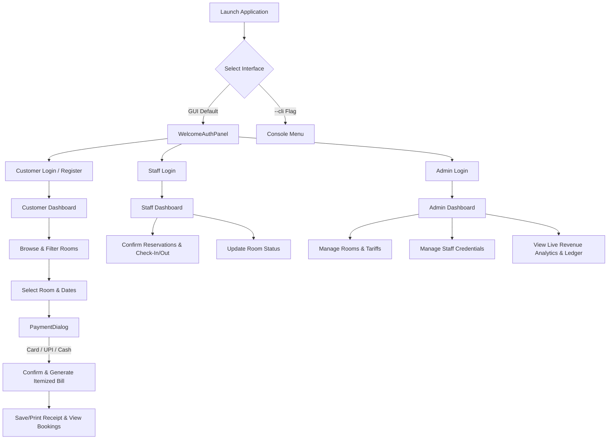

# Astra Hotel Reservation & Management System

**Academic Standard:** KTU 2024 Scheme — S3 Object-Oriented Programming in Java  
**Environment:** Java SE (JDK 17/21/26+), Java Swing (`javax.swing`, `java.awt`), JDBC (SQLite / MySQL)

---

## 1. Project Overview
**Astra Hotel Management System** is a full-featured desktop application built in pure Java implementing an Object-Oriented Programming (OOP) architecture. It provides persistent relational data storage via standard JDBC (SQLite / MySQL) and a desktop interface built with Java Swing, alongside a CLI fallback for automated testing and lab environments.

The system features three distinct operational tiers:
1. **Customer Portal:** Room browsing with category filters, dynamic date range pricing, multi-method payment gateway (Card, UPI, Cash), receipt generation, and booking cancellation.
2. **Hotel Staff Portal:** Front-desk booking confirmations, guest check-in/check-out toggles, room maintenance status updates, and customer directory lookup.
3. **Administrator Portal:** Full system administration, room catalog management (Standard, Deluxe, Suite), staff & administrator credentials management, and real-time revenue & KPI analytics.

---

## 2. Key OOP Concepts Implemented

### A. Inheritance & Polymorphic Hierarchies
1. **User / Person Hierarchy (`com.hotel.domain`):**
   - `Person` (Base Class): Encapsulates `id`, `name`, `phone`, `email`, and `displayDetails()`.
   - `Customer` (extends `Person`): Adds `address`, `password`, and customer booking/cancellation operations.
   - `HotelStaff` (extends `Person`): Adds `role`, `password`, and front-desk management operations.
   - `Admin` (extends `HotelStaff`): Demonstrates **multilevel inheritance**, adding room/staff administration privileges.

2. **Room Hierarchy (`com.hotel.domain`):**
   - `Room` (Base Class): Attributes (`roomNo`, `roomType`, `price`, `status`, `description`).
   - `StandardRoom` (extends `Room`): Standard room specifications.
   - `DeluxeRoom` (extends `Room`): Deluxe ocean/city specifications.
   - `SuiteRoom` (extends `Room`): Luxury suite and presidential specifications.
   - *Polymorphic Reconstruction:* Database queries inspect `room_type` and instantiate concrete room subclasses dynamically at runtime.

3. **Payment Hierarchy (`com.hotel.domain`):**
   - `Payment` (Base Class): `paymentId`, `amount`, `paymentMethod`, `paymentStatus`, `paymentDate`, `generateBill()`.
   - `CardPayment` (extends `Payment`): Card number masking (`**** **** **** 1234`) and cardholder details.
   - `UpiPayment` (extends `Payment`): VPA / UPI ID integration.
   - `CashPayment` (extends `Payment`): Front desk cash collection documentation.
   - *Polymorphism & Overriding:* `generateBill()` is overridden across subclasses with `super.generateBill()` chaining.

### B. Encapsulation & Design Patterns
- **Data Hiding:** Private and protected fields accessed safely via getters and setters.
- **Repository Pattern (`com.hotel.repository`):** Decoupled JDBC persistence using parameterized `PreparedStatement` to prevent SQL injection.
- **Singleton Connection Manager (`com.hotel.database.DatabaseConnection`):** Thread-safe JDBC connection handling with automatic foreign key enforcement.
- **Dependency Injection:** Services and repositories injected cleanly across Swing panels and console portals.

---

## 3. Database & JDBC Driver Setup

The project uses zero-configuration **SQLite** (`hotel_astra.db`) as its default database, enabling immediate execution on any evaluation machine without local database server setup.

All required driver JAR files are located in the `lib/` directory:
- `lib/sqlite-jdbc.jar` (SQLite JDBC Driver)
- `lib/slf4j-api.jar` (SLF4J Logging API)
- `lib/slf4j-simple.jar` (SLF4J Logger Implementation)

*(Optional MySQL Configuration):* To connect to MySQL instead of SQLite, update the connection parameters in `com/hotel/database/DatabaseConnection.java` to point to `MYSQL_URL = "jdbc:mysql://localhost:3306/hotel_astra"`.

---

## 4. How to Compile and Run

### Prerequisites
- Java Development Kit: JDK 17, JDK 21, or newer.
- Verify installation by running:
  ```bash
  java -version
  javac -version
  ```

### Step 1: Open Terminal in Project Directory
```bash
cd "d:\Roshen\Java Project"
```

### Step 2: Compile the Application

- **Windows (PowerShell / Command Prompt):**
  ```powershell
  javac -cp ".;lib/*" com/hotel/database/*.java com/hotel/domain/*.java com/hotel/repository/*.java com/hotel/service/*.java com/hotel/ui/*.java com/hotel/ui/swing/*.java com/hotel/Main.java
  ```

- **Linux / macOS:**
  ```bash
  javac -cp ".:lib/*" com/hotel/database/*.java com/hotel/domain/*.java com/hotel/repository/*.java com/hotel/service/*.java com/hotel/ui/*.java com/hotel/ui/swing/*.java com/hotel/Main.java
  ```

---

### Step 3: Run the Application

#### A. Launch Java Swing Desktop GUI (Default Mode):
- **Windows (PowerShell / Command Prompt):**
  ```powershell
  java -cp ".;lib/*" com.hotel.Main
  ```

- **Linux / macOS:**
  ```bash
  java -cp ".:lib/*" com.hotel.Main
  ```

#### B. Launch Console CLI Mode (Fallback):
- **Windows:**
  ```powershell
  java -cp ".;lib/*" com.hotel.Main --cli
  ```

- **Linux / macOS:**
  ```bash
  java -cp ".:lib/*" com.hotel.Main --cli
  ```

---

## 5. Default Seeded Data & Credentials

On first startup, the database automatically initializes tables and seeds standard records:

| Role | Username / ID / Email | Password / PIN | Description |
| :--- | :--- | :--- | :--- |
| **Administrator** | `999` or `admin@hotel.com` | `1234` / `admin` | Full Master Admin privileges |
| **Hotel Staff 1** | `1` or `alice@hotel.com` | `staff` | General Manager |
| **Hotel Staff 2** | `2` or `bob@hotel.com` | `staff` | Receptionist |
| **Customer** | `john@example.com` | `password123` | Pre-registered Test Guest |

### Seeded Rooms:
- **Room 101:** Standard Room ($50.00 / night, Available)
- **Room 102:** Standard Room ($60.00 / night, Available)
- **Room 201:** Deluxe Room ($90.00 / night, Available)
- **Room 202:** Deluxe Room ($100.00 / night, Available)
- **Room 301:** Suite Room ($180.00 / night, Available)
- **Room 302:** Suite Room ($220.00 / night, Available)

---

## 6. End-to-End System Workflow



### Complete Guest Journey:
1. **Register / Login:** New customers register with Name, Phone, Email, and Address; existing customers log in with their email or phone.
2. **Browse Rooms:** Filter by category (Standard, Deluxe, Suite) with real-time tariff calculations.
3. **Reservation & Payment:** Select check-in and check-out dates, pick a payment method (UPI, Card with masked number preview, or Cash), and execute payment.
4. **Itemized Receipt:** View formatted receipt with duration, tariffs, and transaction timestamps, with the option to save to a local text file.
5. **Manage Bookings:** View active bookings, reprint receipts at any time, or cancel reservations with automated room availability release.
